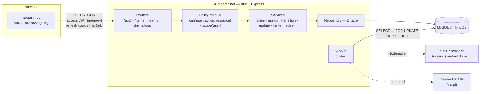
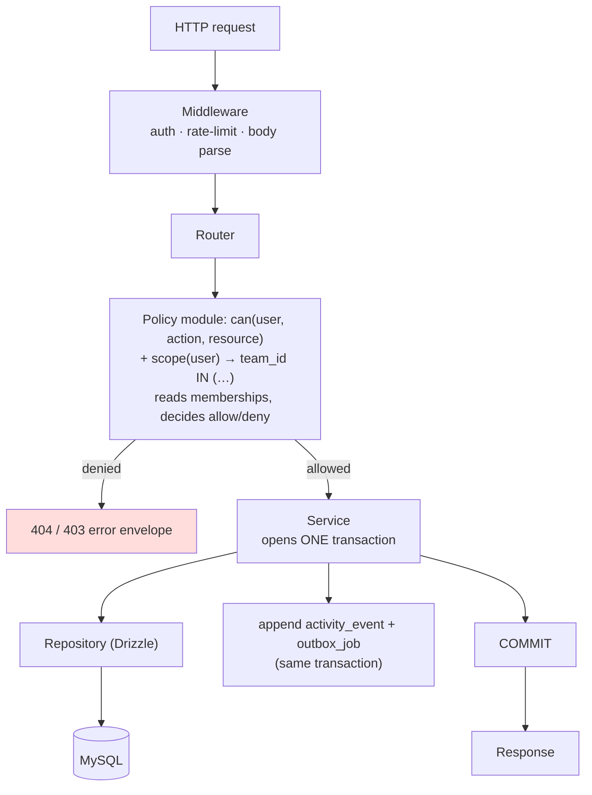
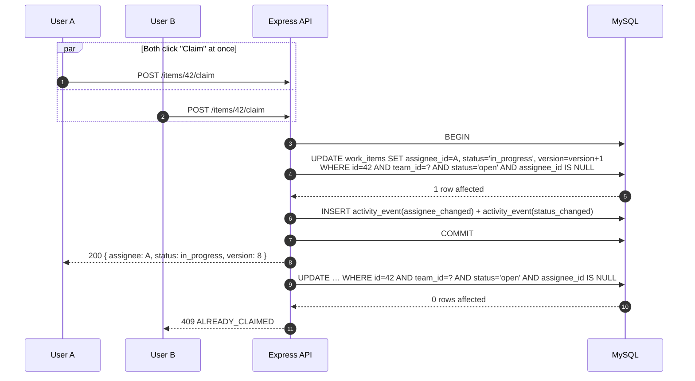
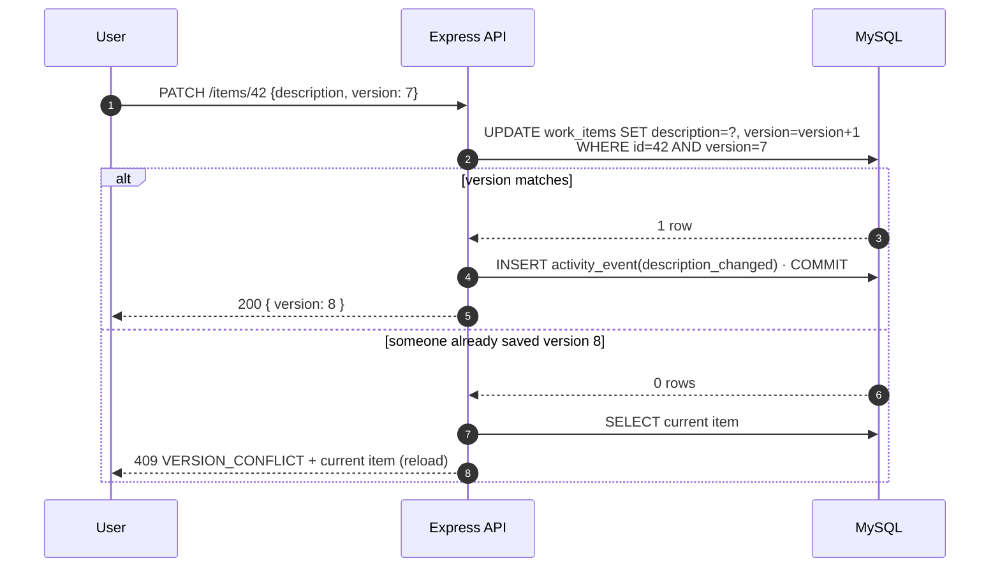
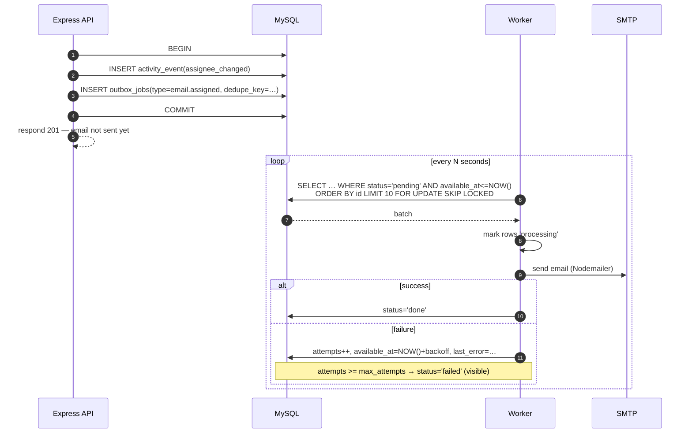
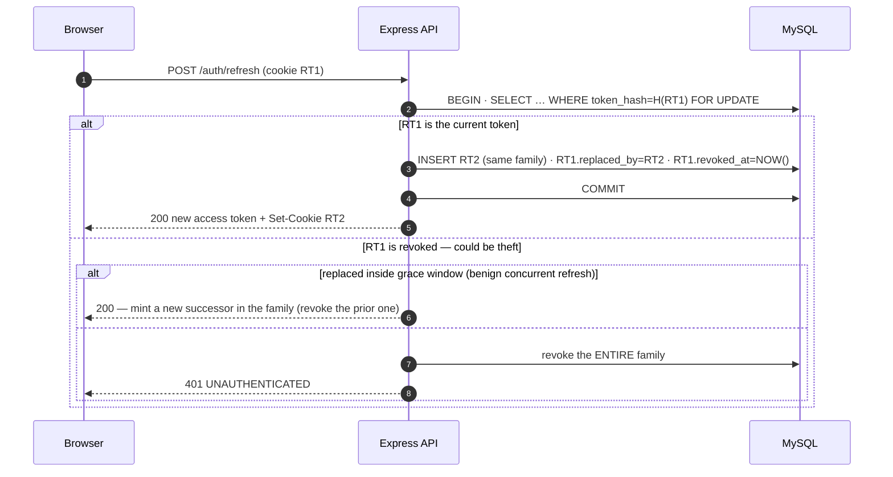
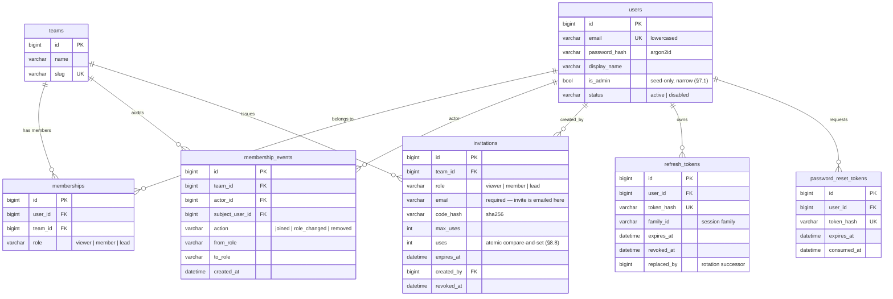
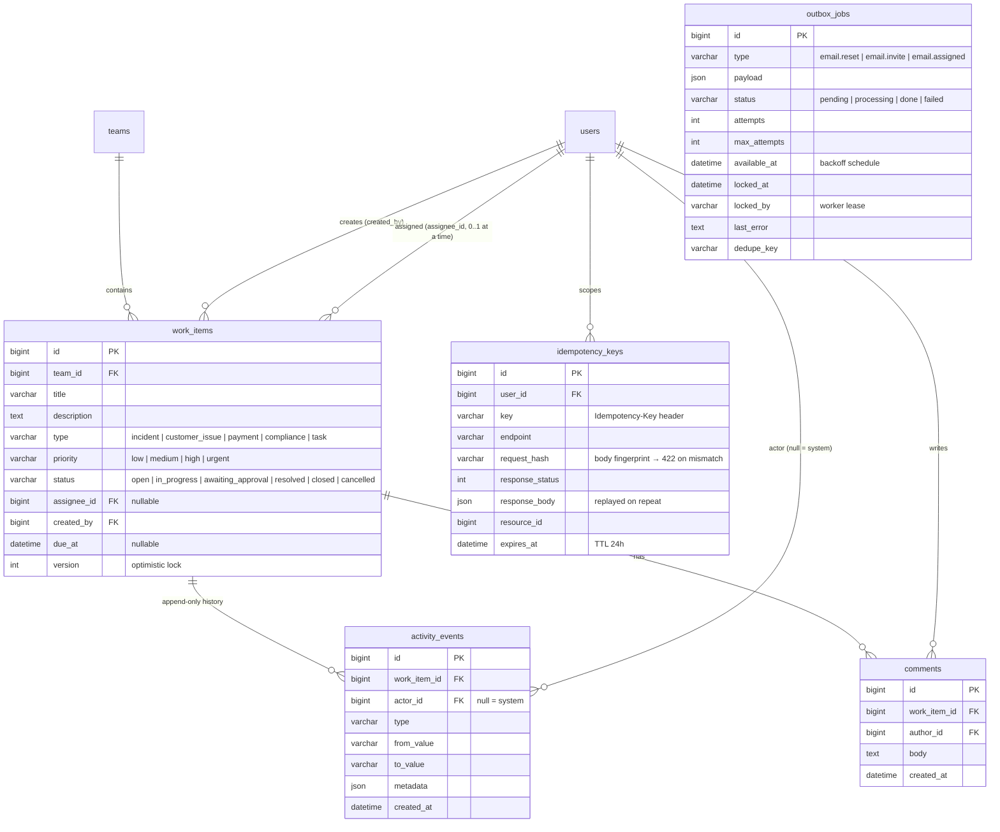
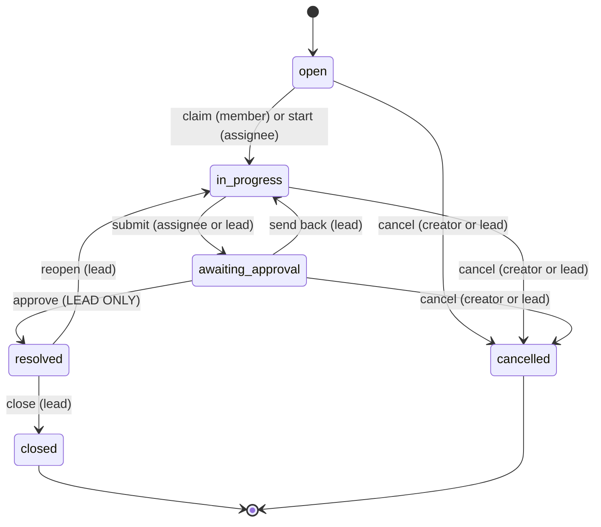

# Architecture

Static structure, the write path, the async path, and auth — in pictures.

---

## 1. System overview

Everything stateful lives in MySQL. The API container is **stateless** — any number
could run behind a load balancer. The worker is a clean seam inside the same container
for dev, movable to its own container in prod with no code change.

---

## 2. Layering (request → response)

The rule the whole codebase obeys: **a business change, its activity event, and any
outbox job are written in a single transaction.** There is no code path that writes
one without the others.

---

## 3. Write path — the correctness spine

### 3.1 Two users claim the same item

The database picks the winner. There is no read-then-write window to lose.

### 3.2 Stale edit

---

## 4. Async path — transactional outbox

- Enqueue is **atomic with the business change** — a lost email would mean a lost job row,
  which can't happen.
- Delivery is **at-least-once**; a `dedupe_key` makes the handler effectively once.
- `SKIP LOCKED` lets many workers run without stepping on each other.

---

## 5. Auth — refresh rotation with reuse detection

Closed registration sits in front of this: an account can only be created by redeeming an
email-bound invitation, and redemption is the same atomic compare-and-set as claiming an
item (§8.8 of the design).

---

## 6. Data model

Split into two diagrams for readability. `work_items` has **two** foreign keys to
`users` (`created_by` and `assignee_id`), so it is drawn with two labelled relationships
rather than one.

### 6.1 Identity & access

### 6.2 Work & asynchronous infrastructure

`outbox_jobs` has **no foreign keys by design** — it references entities only through its
JSON `payload`, so a job can be enqueued in the same transaction as any change without
coupling to one table's lifecycle.

### 6.3 Keys and constraints not visible above

| Table | Constraint |
|---|---|
| `memberships` | `UNIQUE(user_id, team_id)`, `INDEX(team_id, role)` |
| `refresh_tokens` | `INDEX(user_id)`, `INDEX(family_id)` |
| `invitations` | `INDEX(team_id)`, `INDEX(code_hash)` |
| `idempotency_keys` | `UNIQUE(user_id, key)` |
| `outbox_jobs` | `UNIQUE(dedupe_key)`, `INDEX(status, available_at, id)` |
| `work_items` | `INDEX(team_id, status, priority)`, `INDEX(team_id, created_at, id)`, `INDEX(assignee_id, status)`, `INDEX(team_id, assignee_id)` |
| `activity_events` | `INDEX(work_item_id, id)` — append-only, never updated |
| `membership_events` | `INDEX(team_id, id)` — append-only |

---

## 7. Work item lifecycle

Every arrow writes an `activity_event` in the same transaction as the status change.
Cancellation is allowed only from `open` / `in_progress` / `awaiting_approval`, never from
`resolved`. An item is never `in_progress` without an assignee.

---

## 8. Sync vs async boundary

| Synchronous (in the request) | Asynchronous (outbox → worker) |
|---|---|
| Create / edit / claim / transition | Email: reset, invite, assigned |
| Authorization decision | (anything slow or external, later) |
| Activity event write | |
| Idempotency key + stored response | |
| Outbox row insert | |

If it must be consistent with the item, it's synchronous. If it's a side effect that can
fail and retry, it's a job.
